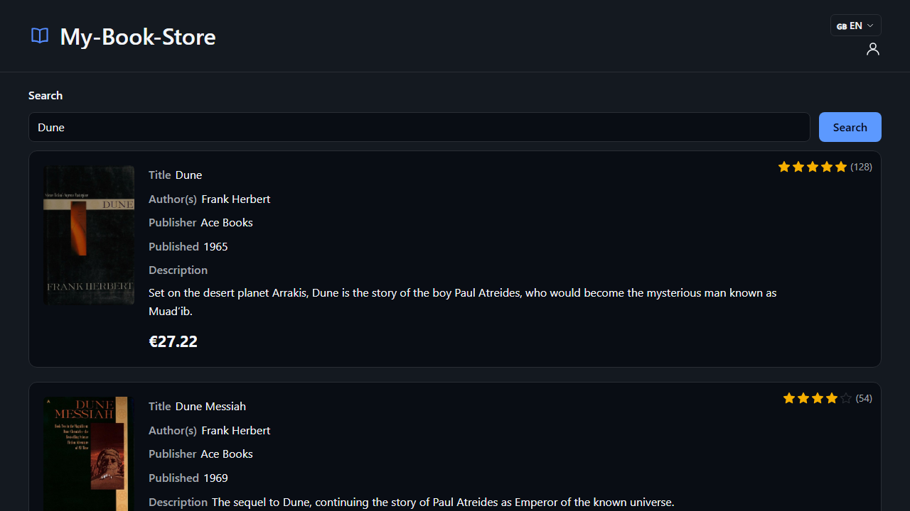
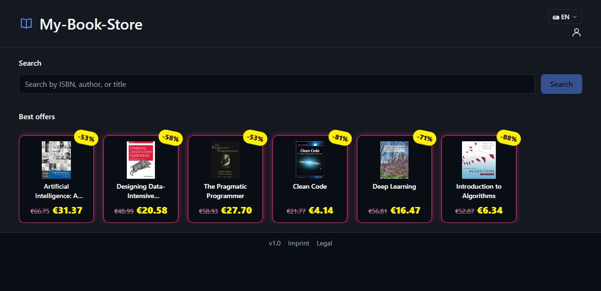
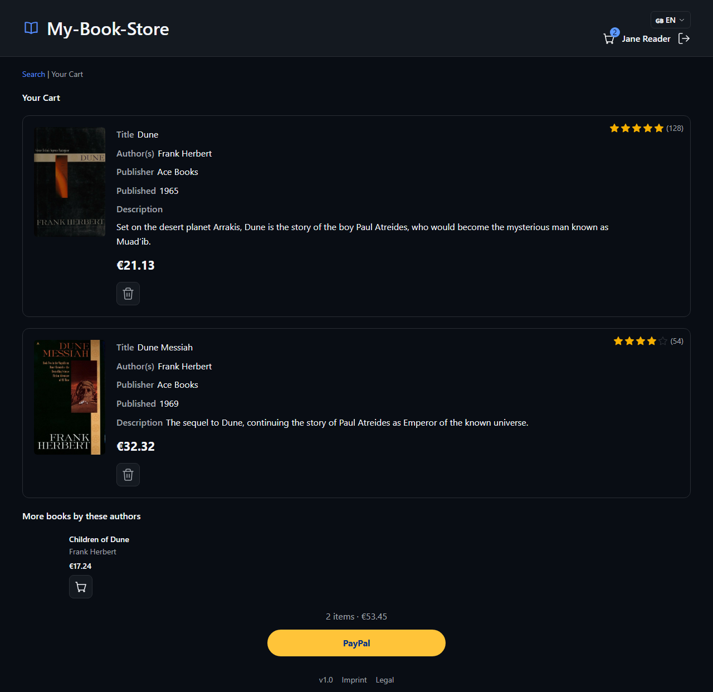

# My Book Store

A small Angular demo book store: search for books, sign in with Google, add them to a cart, and browse a couple of "fun" extras (author recommendations, a deliberately garish promo section). It talks to the real Google Books API and real Google OAuth — there is no backend of its own.

**The actual point of this project isn't the book store.** It exists to explore **Spec-Driven Development (SDD)** using **[OpenSpec](https://github.com/Fission-AI/OpenSpec)** and **Claude Code**: every feature in this repo was proposed, specified, designed, and implemented through OpenSpec's propose → apply → archive workflow, with Claude Code doing the implementation against those specs. See [`openspec/specs/`](openspec/specs/) for the current behavior contracts and [`openspec/changes/archive/`](openspec/changes/archive/) for the full history of how each feature was specified before it was built.

## Screenshots

| Search results | "Always-on" promo section | Cart |
| --- | --- | --- |
|  |  |  |

## Tech Stack

- **[Angular 22](https://angular.dev/)** — standalone components, signals (`signal`/`computed`/`effect`), the new `@if`/`@for` control-flow syntax, zoneless change detection
- **[RxJS](https://rxjs.dev/)** — HTTP request composition (`forkJoin`, `map`)
- **[Tailwind CSS v4](https://tailwindcss.com/)** + CSS custom-property design tokens for theming (dark mode only)
- **[TypeScript](https://www.typescriptlang.org/)**
- **[Vitest](https://vitest.dev/)** — unit tests, run via `ng test`
- **[Playwright](https://playwright.dev/)** — end-to-end tests
- **[ESLint](https://eslint.org/)** (`angular-eslint`) — linting

## External APIs

- **[Google Books API](https://developers.google.com/books)** (`books.googleapis.com`) — book search by title/author/ISBN, author-based recommendations, and a random-books feed for the promo section. Works without an API key at a lower request quota (see [Development setup](#development-setup)).
- **[Google Identity Services](https://developers.google.com/identity)** (OAuth2) + the `oauth2/v3/userinfo` endpoint — "Sign in with Google," used to gate the cart and personalize the header.

## Architecture

A single-page Angular app with no backend of its own — both arrows below leave the browser directly for Google's public APIs.

```
+--------------------------------------------------------------------------+
|                        Browser -- Angular 22 SPA                         |
|                                                                          |
| +--------------+   +------------------------------------------------+    |
| | app-header   |   |                  router-outlet                 |    |
| +--------------+   |                                                |    |
|                    |  /            -> BookSearch                    |    |
|                    |  /cart        -> CartPage                      |    |
|                    |  /impressum   -> ImpressumPage                 |    |
|                    |  /legal       -> LegalPage                     |    |
|                    +------------------------------------------------+    |
|                                                                          |
| +--------------+                                                         |
| | app-footer   |                                                         |
| +--------------+                                                         |
|                                                                          |
| BookSearch composes:                                                     |
|   PromoSection -> PromoCard (x n)  -- garish 'always-on' promo demo      |
|   BookCard (x n)                   -- search results                     |
|   BookRecommendations -> RecommendationCard -- shown on CartPage         |
|   Breadcrumb                       -- on Cart / Impressum / Legal        |
|                                                                          |
| Shared services (signal-based DI, no backend):                           |
|   GoogleBooks - search() / searchByAuthors() / searchRandom()            |
|   GoogleAuth  - login() / logout(), current-user signal                  |
|   Cart        - add() / remove(), in-memory, clears on sign-out          |
|   Language    - en/de, persisted to localStorage                         |
+--------------------------------------------------------------------------+

              |                                        |
              v                                        v

  +--------------------------------+    +--------------------------------+
  |   Google Books API             |    | Google Identity Services       |
  | books.googleapis.com           |    | + oauth2/v3/userinfo           |
  | (search, ISBN lookup,          |    | ("Sign in with Google")        |
  |  author/random queries)        |    |                                |
  +--------------------------------+    +--------------------------------+
```

## Spec-Driven Development with OpenSpec

- `openspec/specs/<capability>/spec.md` — the current, always-up-to-date behavior contract for each capability (e.g. `book-search`, `shopping-cart`, `promo-section`, `legal`).
- `openspec/changes/archive/` — every past change, in the exact propose → design → tasks shape it was implemented from.
- `openspec/trace-matrix.md` — generated via `npm run trace`; maps each spec scenario to the e2e test(s) that exercise it.
- `openspec/config.yaml` — the project-specific guidance OpenSpec's workflows follow (coverage thresholds, lint gate, commit conventions).

## Development setup

Copy `src/environments/environment.example.ts` to `src/environments/environment.ts` and fill in:
- `googleBooksApiKey` — a Google Books API key (optional; the app works without one at a lower request quota)
- `googleOAuthClientId` — a Google OAuth 2.0 Web Client ID (required for sign-in to work)

## Development server

To start a local development server, run:

```bash
npm start
```

Once the server is running, open your browser and navigate to `http://localhost:4200/`. The application will automatically reload whenever you modify any of the source files.

## Building

To build the project run:

```bash
npm run build
```

This will compile your project and store the build artifacts in the `dist/` directory.

## Running unit tests

```bash
npm test
```

Runs the [Vitest](https://vitest.dev/) suite with coverage (`ng test --coverage`).

## Running end-to-end tests

```bash
npm run e2e
```

Runs the [Playwright](https://playwright.dev/) suite against a local dev server.

## Linting

```bash
npm run lint
```

## Additional Resources

For more information on using the Angular CLI, including detailed command references, visit the [Angular CLI Overview and Command Reference](https://angular.dev/tools/cli) page.
